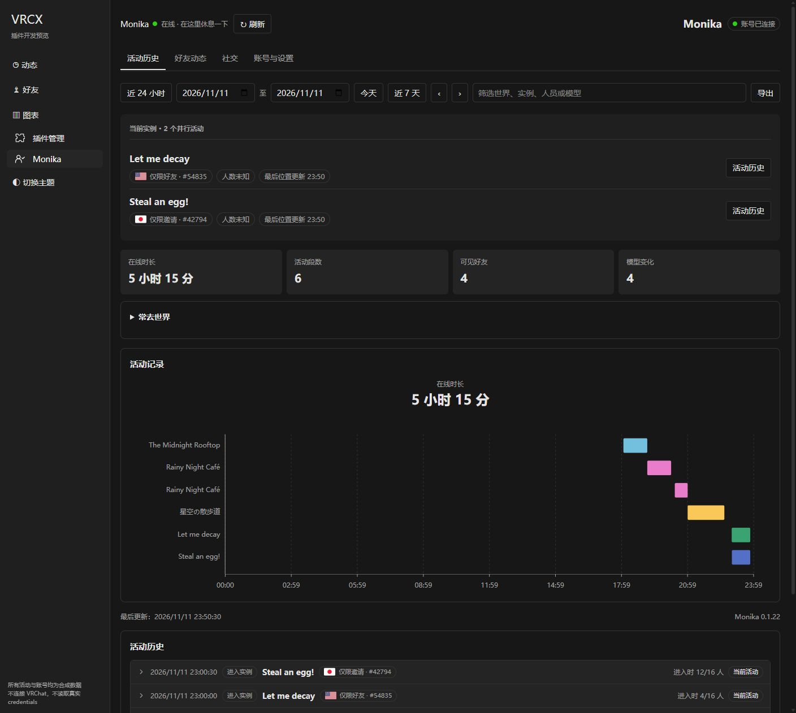
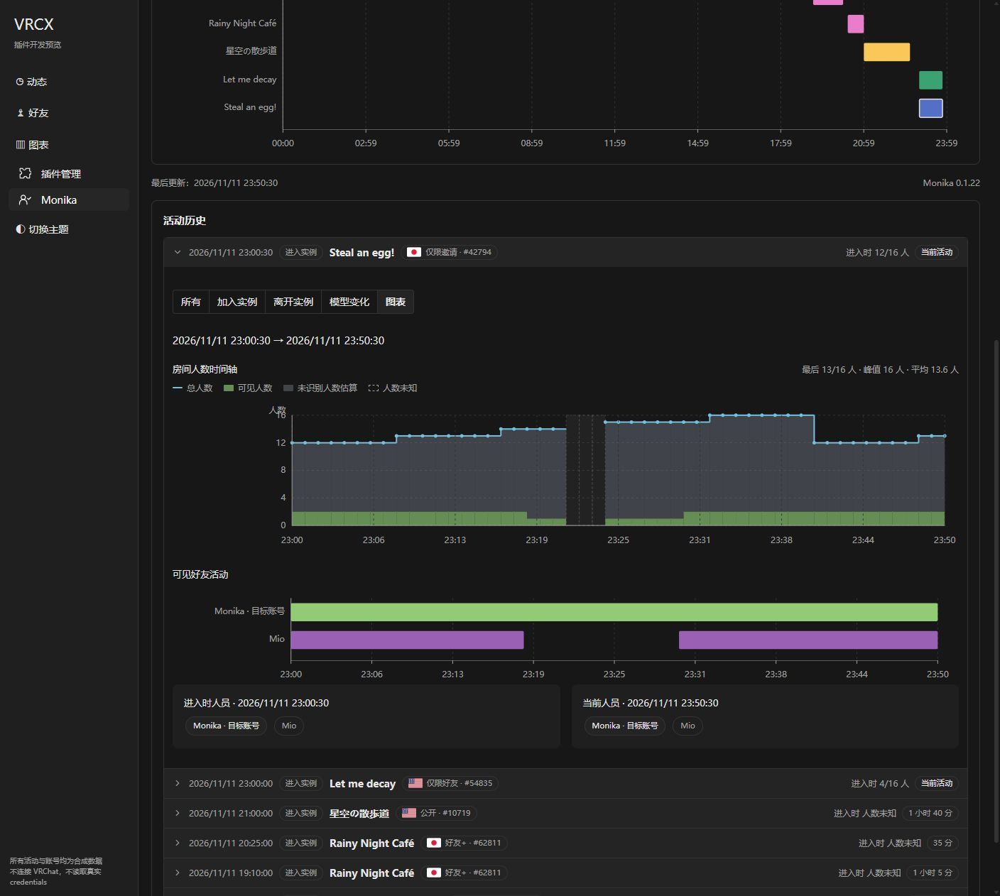
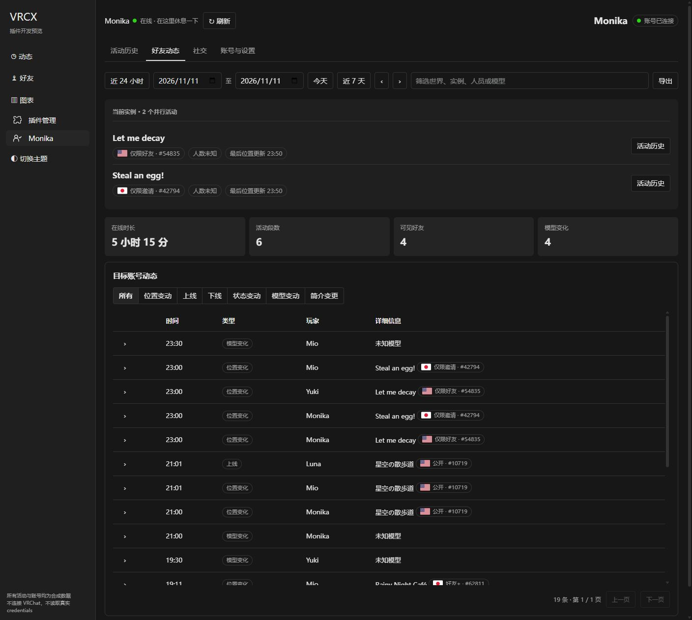
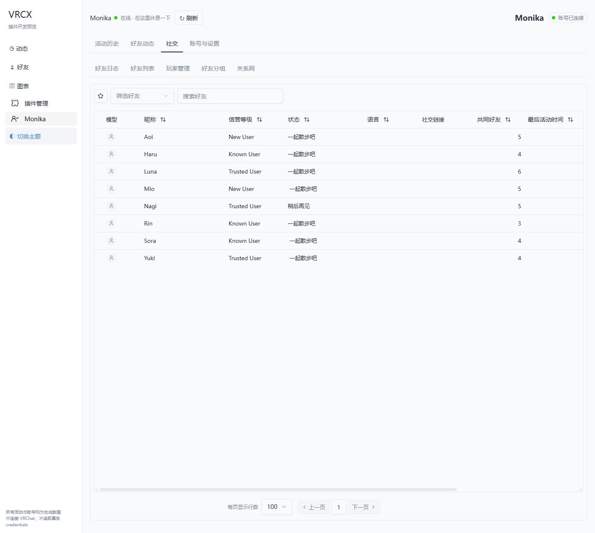
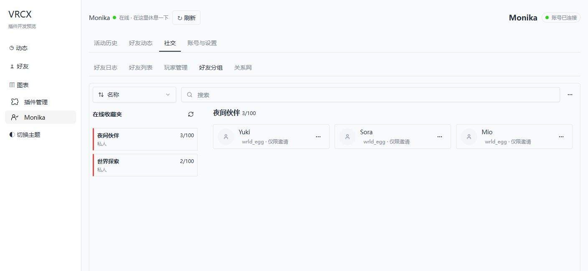
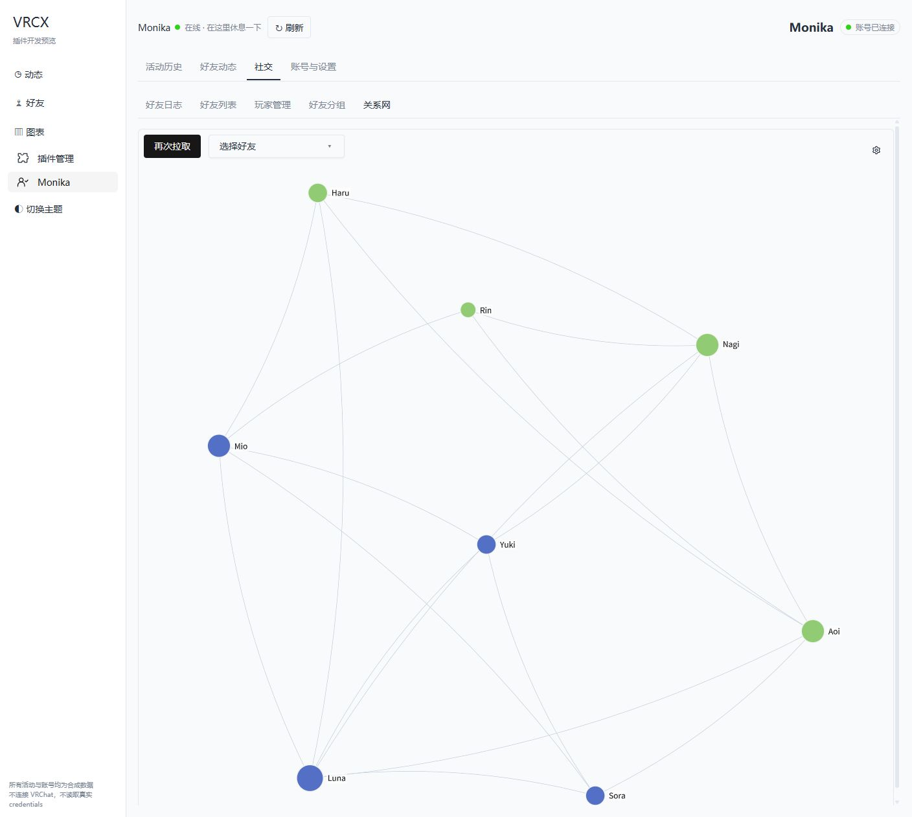
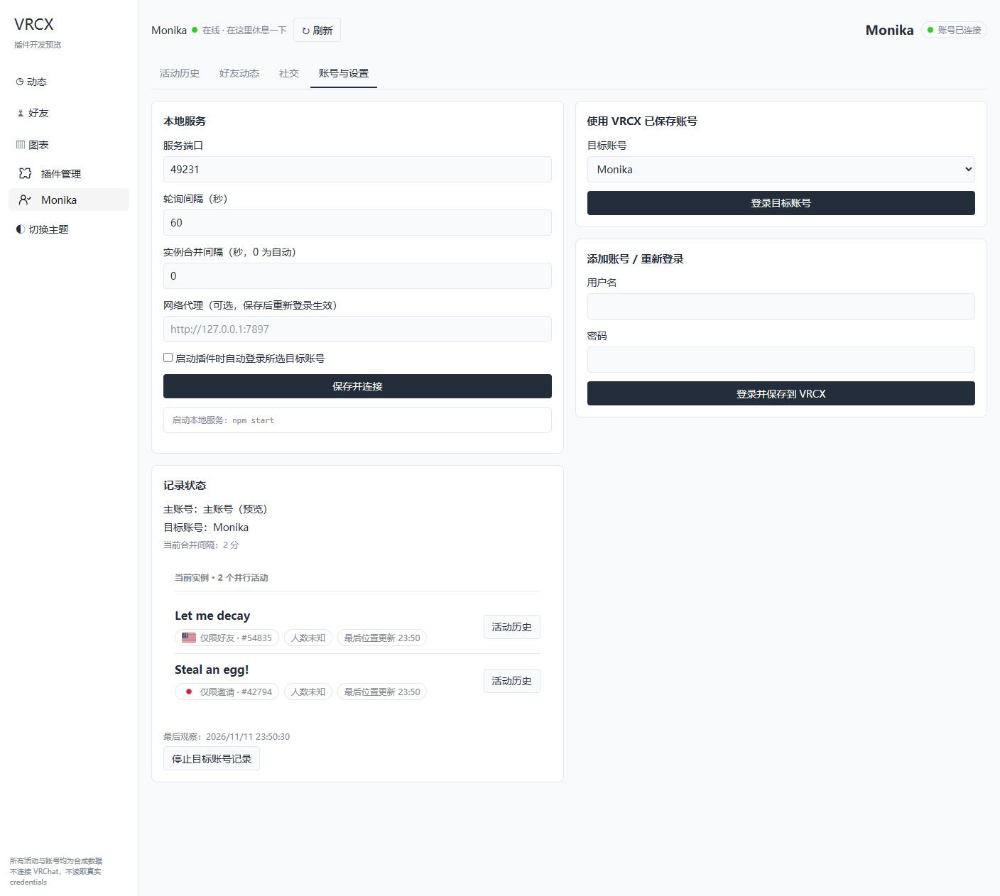

# Monika for VRCX

Monika 是运行于 **VRCX Plugin System Fixed** 的目标账号活动记录插件。它通过独立的 VRChat 云端会话观察目标账号及其可见好友，在 VRCX 中查看活动历史、实例人数、模型变化和社交资料。

当前版本：**0.1.22**。安装由两个部分组成：VRCX 中的单文件插件 `monika.js`，以及持续运行的 Node.js 本地服务。

## 安装

### 1. 准备环境

| 组件 | 要求 |
| --- | --- |
| VRCX | 支持 `custom.js`，并提供现代 `$pinia`、`configRepository` 与原生 SQLite 接口 |
| 插件框架 | **vrcx-plugin-system-fixed 3.1.0-fixed.1**，或兼容的后续版本 |
| Node.js | **22.16.0 或更新版本**，从 [Node.js 官方网站](https://nodejs.org/) 安装 |
| VRChat 账号 | VRCX 已完成主账号登录，并有一个不同于主账号的目标账号 |

界面及数据库适配基于 VRCX `2026.09.16` 源码快照。Fixed 框架单独维护；获取框架项目提供的 `dist/custom.js`。本仓库的发行包只包含 Monika 插件与本地服务。

### 2. 安装 Fixed 框架

1. 完全退出 VRCX。
2. 备份已有 `%APPDATA%\VRCX\custom.js`，然后把 **Fixed 框架**的 `dist/custom.js` 复制到该位置。
3. 便携版或自定义配置目录使用 VRCX 实际读取 `custom.js` 的目录。
4. 重启 VRCX，确认侧栏出现 **插件管理**。

`custom.js` 是框架，`monika.js` 是业务插件，两者的安装位置不同。

### 3. 解压 Monika 并启动服务

下载本项目 Releases 中的 `Monika-v0.1.22.zip`，完整解压到一个固定目录，例如 `D:\Apps\Monika`。保持 `server/`、`src/`、`dist/` 和 `package.json` 的相对位置。

在解压目录打开 PowerShell：

```powershell
node --version
npm start
```

**发行包运行无需 `npm install` 或构建。** 也可以在解压目录执行：

```powershell
.\scripts\start-monika.ps1
```

终端应显示 `Monika 本地服务：http://127.0.0.1:39123`。保持终端和服务运行，按 `Ctrl+C` 停止。服务默认只监听本机。

自定义端口或数据目录：

```powershell
node server/main.mjs --port 39124 --data-dir "D:\MonikaData"
```

### 4. 从本地文件导入插件

1. 在 VRCX 的 **插件管理 → 导入本地插件** 中选择解压目录里的 `dist/monika.js`。
2. 导入后默认启用，侧栏会出现 **Monika**。
3. 完成 VRCX 主账号登录，再打开 **Monika → 账号与设置**。
4. 默认服务端口为 `39123`；如服务使用其他端口，填写相同端口并点击 **保存并连接**。

安装通过本地文件完成，无需填写远程插件仓库地址。Fixed 将文件内容副本保存到 VRCX 的 IndexedDB，启动时从该副本加载；原文件不必一直位于原路径。本地服务仍需运行，才能认证目标账号并采集新数据。

### 5. 登录目标账号并开始记录

在 **使用 VRCX 已保存账号** 中选择目标账号，点击 **登录目标账号**；或在 **添加账号 / 重新登录** 中填写用户名、密码，点击 **登录并保存到 VRCX**。按提示完成二步验证。

登录成功后，右上角显示 **账号已连接**。左上角另行显示目标账号的 VRChat 在线状态：云端会话已登录和账号在游戏中在线是两个状态。

目标账号活动且位置可见时开始记录。可以开启 **启动插件时自动登录所选目标账号**。停止记录会关闭该自动登录选项；禁用、移除或重新加载插件会停止当前记录，之后可手动登录，或按已保存的自动登录设置恢复。主账号注销或登录切换时，目标账号认证与同步会暂停。

### 从源码安装

源码包含构建所需的 VRCX 最小快照，不需要另行克隆完整 VRCX 或旧版插件框架。

```powershell
npm ci
npm run build
npm start
```

随后从 Fixed 管理页导入生成的 `dist/monika.js`。源码开发依赖只用于构建、测试和预览，本地服务使用 Node.js 内置模块。

### 更新已有安装

1. 停止 Monika 本地服务，备份服务数据目录和 VRCX 数据库。
2. 解压新发行包，保留原来的 `data/`；使用自定义数据目录时继续传入同一个 `--data-dir`。
3. 启动新版服务。
4. 在 Fixed 管理页再次导入 **同名的 `monika.js`**，更新已保存副本。按之前的启用状态启用插件并登录目标账号。

**“重新加载”只重新执行 Fixed 已保存的文件副本。** 修改源码、重新构建或替换磁盘文件后，必须重新导入才会更新代码。

从旧版通过 URL 安装迁移时，先移除旧的 Monika 地址安装条目，再导入本地文件，避免两个安装条目使用相同插件 ID。框架仅在更新 `custom.js` 时需要重启 VRCX；Monika 更新通常只需重启服务并重新导入插件。更新保留旧历史，不批量合并或补造旧记录。

## 功能介绍与截图

以下截图由 **0.1.22 当前构建**在实际 Fixed 框架 bundle 下生成；VRCX 宿主接口、账号、好友、世界活动和关系网均为合成示例。预览不连接 VRChat，不读取真实登录信息。预览端口为 `49231`，实际服务默认端口为 `39123`。

### 活动历史与并行实例

- 默认查看最近 24 小时；支持今天、近 7 天、自定义日期、前后一天和文本筛选。
- 展示当前实例、最后位置更新时间、活动段数、在线时长、可见好友和模型变化统计。
- 活动时间轴按完整实例位置分段。点击世界标签或色块定位到对应历史条目并展开图表。
- 常去世界统计默认折叠；历史条目可展开、分页查看。
- 同一目标账号在多个客户端活动时，已观察到的不同实例可以并行存在，每个实例独立维护人员、模型和人数采样。

在线时长合并重叠活动区间，避免把并行时间重复计算；各实例的累计时长按各自区间统计。短时间返回相同实例可合并原活动，超过合并间隔后再出现则形成新段。没有客户端标识时，判断依据是云端报告的完整实例位置。



### 实例人数、可见人员和模型历史

展开活动条目，使用 **所有 / 加入实例 / 离开实例 / 模型变化 / 图表** 查看事件或图表。

房间人数时间轴显示 API 总人数、可见人数、未识别人数估算和未知缺口，并统计有效样本的最后人数、峰值与平均人数。下方的可见好友时间轴按人员合并多次进出，保留进入时与最后人员快照，便于对照变化。



| 项目 | 来源与范围 |
| --- | --- |
| 总人数 / 容量 | 目标账号独立会话查询实例 API 的 `userCount` / `n_users` 与容量字段 |
| 可见人数 | 已观察到的目标账号自身，以及位置对该账号可见的好友 |
| 未识别人数估算 | 总人数减去已知人数，无法据此识别陌生玩家；采样不同步时可能有异常 |
| 人数未知 | 查询失败、无权访问或样本过期，显示缺口而非 0 人 |
| 模型变化 | API 提供模型 ID 时按 ID 记录；只有图片时明确标为图片变化、ID 未知 |

人数采样不会延长目标账号活动，也无法补全新版服务采集前的历史。模型与世界名称按目标账号权限补查；无法读取的模型保留未知状态，不根据图片推断 ID。

### 好友动态

按目标账号的隔离数据库显示自己与可见好友的位置、上线、下线、状态、模型和简介变化。支持多选事件类型、文本搜索、日期范围、分页和展开详情；简介变更保留差异及链接比较。

世界名称可打开 VRCX 原生世界窗口，模型信息可打开原生模型窗口。详情读取使用目标账号独立会话，避免把目标账号资料写进主账号缓存。**原生世界窗口中的加入、邀请和收藏等操作仍使用 VRCX 主账号。**



### 社交资料、好友列表与分组

社交页面直接编译复用 VRCX 原始 Vue 组件与表格控件，在目标账号上下文内运行：

| 页面 | 功能 |
| --- | --- |
| 好友日志 | 查看观察期间的好友增减、昵称变化等记录；首次完整拉取建立基线 |
| 好友列表 | 好友搜索、筛选、排序、分页、列设置和 API 可读取的公开资料 |
| 玩家管理 | 查看目标账号可读取的屏蔽、静音等管理记录 |
| 好友分组 | 浏览目标账号云端好友收藏分组及分组中的好友 |
| 好友详情 | 查看资料、共同好友、群组、世界和收藏世界等可读取内容 |





这里以资料查询为主。目标账号的删除好友、编辑云端收藏、修改屏蔽、邀请和备注编辑入口已移除，并拒绝相应写入请求。本地表格偏好、关系网缓存与显示设置按目标账号分别保存。

Monika 不显示由主账号游戏日志产生的见面次数、共同游玩时长、最后见面时间等本地统计。好友数据拉取失败保留上一份快照，迟到响应不会覆盖已切换的账号。

### 共同好友关系网

复用 VRCX 原生关系网图表、布局 Worker 和分页查询逻辑，通过目标账号读取共同好友关系。支持再次拉取、选择好友、节点详情、隐藏节点、布局设置、限速、重试和取消。



查询结果与图表偏好按账号保存。关系网遵循 VRChat 的共同好友设置和目标账号权限，只显示查询得到的关系；布局中的距离不代表现实关系强弱。

### 账号与设置



| 设置 | 默认值 | 说明 |
| --- | --- | --- |
| 服务端口 | `39123` | 必须与启动命令一致，范围 `1024–65535` |
| 轮询间隔 | `60` 秒 | 可设置 `30–600` 秒；Pipeline 推送补充实时变化 |
| 实例合并间隔 | `0` | `0` 为自动，通常为两个更新周期；可设 `0–1800` 秒，实际至少一个更新周期 |
| 网络代理 | 空 | 支持 HTTP / HTTPS CONNECT，例如 `http://127.0.0.1:7897`；保存后重新登录生效 |
| 自动登录 | 关闭 | 启动插件后自动登录选定目标账号，需先完成主账号登录 |

页面同时展示主账号、目标账号、当前实例、最后观察时间和停止记录入口。API 请求与 Pipeline 使用同一代理配置；目前没有 SOCKS 代理配置入口。

### 导出与离线查看

活动历史和好友动态顶部的 **导出** 按当前账号及筛选范围生成 JSON 文件，包含可用于后续分析的档案数据。文件名形如 `Monika-usr_…-YYYY-MM-DD.json`。

已经同步进 VRCX SQLite 的历史可在服务停止后查看。服务事件队列用于恢复同步；记录采集仍需要本地服务、有效目标账号会话与网络连接。JSON 导出用于查看和分析，当前没有将导出文件导回数据库的入口。

## 数据来源与记录边界

Monika 观察的是 **目标账号的 VRChat 云端可见数据**。它不读取本机 VRChat 缓存、游戏日志或 OSC，也没有另一台游戏客户端的完整房间遥测。

- 可见好友记录包含目标账号自身与其位置可见的好友，无法记录同房间所有陌生玩家的身份和模型。
- 隐藏、私有或不可访问的位置不创建伪造实例；`traveling` 不独立生成活动段。
- 轮询之间没有被 Pipeline 推送的变化可能遗漏，时间表示观察时间。
- 开始记录前的历史无法倒推；断线、停止或重启后的未观察时间不会补成在线时长。
- 相同实例恢复后可能续用原活动 ID、保留原始开始时间与快照；活动跨度可以包含恢复间隔，图中的未知采样仍保留缺口。
- 单条云端位置报告不是所有客户端的完整状态，长时间未再报告的位置会按合并间隔结束。

## 账号隔离、存储与备份

目标账号 API 与 Pipeline 使用 Node.js 服务自己的 Cookie 会话。插件与本机服务之间使用不携带 Cookie 的浏览器 `fetch`，不调用 VRCX 主账号的原生 HTTP 客户端，也不切换主账号 Cookie 容器。

目标账号登录后，更新 VRCX 保存账号配置中的对应条目；条件写入合并已有内容，保留其他账号和原有登录信息。正在进行主账号登录、自动登录、二步验证或账号切换时，目标账号操作被暂停，旧身份下的迟到认证响应会被丢弃。

| 存储位置 | 内容 | 备份方法 |
| --- | --- | --- |
| 服务默认 `data/`，或 `--data-dir` | 各账号会话、NDJSON 事件队列、服务目录锁 | 停止服务后复制整个目录 |
| VRCX 当前配置的 SQLite | 按目标账号前缀隔离的原生动态 / 社交表、隔离游戏历史投影与 Monika 扩展档案 | 退出 VRCX 后备份实际使用的数据库 |
| VRCX 浏览器配置 | Fixed 导入的插件副本、Monika 连接设置、社交列偏好与关系网缓存 | 保留浏览器配置；Fixed 可单独导出插件文件 |

服务会话和 VRCX 保存账号内容包含敏感登录信息，不能作为可公开的配置模板。仓库忽略规则和发行包白名单排除了 `data/`、日志、完整参考 checkout 与开发依赖；自定义数据目录也应放在仓库外。

移除插件不删除已记录的档案。彻底清理数据前应分别备份上述位置，不能用删除本地脚本代替数据管理。

## 常见问题

| 现象 | 检查方法 |
| --- | --- |
| 没有“插件管理” | 确认 Fixed 的 `custom.js` 位于 VRCX 实际配置目录，完全退出后重启 |
| 提示需要 Fixed 框架 | 当前加载的仍是旧框架；先更新框架，再导入 `dist/monika.js` |
| “服务未连接” | 查看终端是否仍在运行；确认插件端口和服务端口一致，可访问 `http://127.0.0.1:39123/health` |
| `EADDRINUSE` | 端口已被占用；关闭重复服务或换用端口，并同步修改插件设置 |
| 数据目录已锁定 | 同一数据目录只能运行一个服务。异常退出后先确认进程已停止，再清理该目录中的 `service.lock` |
| 保存账号登录失败 | 会话可能过期；从“添加账号 / 重新登录”重新登录并完成二步验证 |
| 主账号登录期间无法操作 | 完成 VRCX 主账号登录后再登录目标账号 |
| 已连接但无活动 | 检查目标账号是否在线、位置是否可见、时间筛选是否正确，以及最后观察时间 |
| 人数未知 / 图中断开 | 目标账号无访问权限、API 失败或样本过期；可见好友数不能替代 API 总人数 |
| 模型名称未知 | API 未提供 ID 或当前账号无法读取详情，保留已有变化记录 |
| 关系网为空 | 尚未拉取、共同好友功能关闭、没有可见关系，或 API 暂时受限 |
| 更新后还是旧界面 | 重新导入同名 `monika.js`；单纯“重新加载”使用的是旧保存副本 |
| PowerShell 不执行启动脚本 | 在解压目录直接执行 `npm start` |

出现 VRChat API 限流时遵循退避等待，避免反复登录或连续刷新。大规模历史目前通过账号事件重放建立内存查询索引，超大档案的查询性能仍需后续优化。

## 开发、构建与打包

```powershell
npm ci
npm run check
npm test
npm run package
```

`npm test` 自动先构建，再运行 Node.js 测试。`npm run check` 检查 JavaScript 语法、VRCX 快照哈希及 Fixed 测试 fixture 来源。`npm run package` 自动构建，生成 `releases/Monika-v0.1.22.zip`、解压目录和 `.zip.sha256` 校验文件。发行包内另附逐文件 `SHA256SUMS.txt`。

```powershell
npm run preview
```

访问终端提示的 `http://127.0.0.1:49231`，使用合成数据验证界面。预览加载固定的真实 Fixed bundle，通过其本地文件导入 API 安装 Monika；数据库在内存中，外部 VRChat 请求被阻止。预览宿主全局样式只用于开发，实际 VRCX 继续提供自己的样式。

| 路径 | 用途 |
| --- | --- |
| `src/` | 插件生命周期、视图、账号隔离数据库与原生窗口适配 |
| `src/native-ui/` | 原生 Vue 组件的目标账号适配器 |
| `server/` | 独立 VRChat 认证、API、Pipeline、采集与同步队列 |
| `vendor/vrcx/` | 可追溯的 VRCX 最小源码快照、上游许可证和文件哈希 |
| `tests/` | SQLite、认证隔离、活动归并、人数、UI 与真实 Fixed 集成测试 |
| `tests/fixtures/` | 仅测试 / 预览使用的 Fixed bundle 与来源记录 |
| `scripts/` | 构建、检查、打包、预览与诊断工具 |
| `docs/` | 架构说明与当前版本合成数据截图 |
| `dist/` / `releases/` | 生成的插件与发行包，Git 忽略 |

构建生成 `src/vendor-vrcx.mjs`、`src/archive.mjs` 和原生用户默认字段，保留账号数据库 / 事件处理逻辑的上游来源。原始 VRCX 文件保持不变，必要的组件调整在构建期间由 `scripts/native-source-adaptations.mjs` 应用。

GitHub Actions 执行检查、测试和打包，上传构建产物供下载，不自动发布 Release。关于账号隔离和数据流，见源码仓库中的 [架构说明](docs/architecture.md)。

维护者诊断工具 `scripts/probe-instance-count.mjs` 仅查询指定账号实例人数；`scripts/recover-vrcx-credential.mjs` 默认验证会话，显式 `--restore` 才会备份并条件恢复保存账号条目。这些工具可能读取实际会话，不属于安装流程，也不包含在发行包中。

## 来源、适配与许可证

Monika 是独立的业务插件，与插件框架分别构建和发布。它使用的 **VRCX Plugin System Fixed** 是 [vrcx-plugin-system/vrcx-plugin-system](https://github.com/vrcx-plugin-system/vrcx-plugin-system) 的维护 fork，保留 Bluscream 及贡献者的上游来源和 MIT 许可。Fixed 的现代侧栏、Vue Router、生命周期及本地导入能力由框架统一提供。

本次整理移除了 Monika 重复修补框架导航的逻辑、旧框架构建 / 安装脚本和地址安装优先的说明，使用 Fixed 的公开导航接口与本地文件导入流程。真实框架集成测试覆盖导入、重新加载、移除、主账号保存信息保持，以及避免重复包装路由。更改记录见 [CHANGELOG.md](CHANGELOG.md)。

VRCX 复用源码来自 [vrcx-team/VRCX](https://github.com/vrcx-team/VRCX)，快照版本 `2026.09.16`，提交 [`267cb69138f0adc5127872fcce64bb0c785f7b9f`](https://github.com/vrcx-team/VRCX/commit/267cb69138f0adc5127872fcce64bb0c785f7b9f)。原始文件清单及 SHA-256 位于源码仓库的 `vendor/vrcx/SOURCE.json`，对应 MIT 许可证位于 `vendor/vrcx/LICENSE`。

Monika 代码使用 [MIT License](LICENSE)。编译进插件的 VRCX 与第三方组件许可见发行包中的 `dist/THIRD-PARTY-NOTICES.txt`；Fixed 测试 fixture 保留其独立许可，未包含在 Monika 发行包内。Monika 与 Fixed 均为社区项目。

当前验证包含自动化回归、实际 Fixed bundle 集成、合成浏览器 UI 和独立发行包启动检查。真实 VRChat 双账号认证、代理网络与不同 VRCX 安装环境仍需实际联调。
