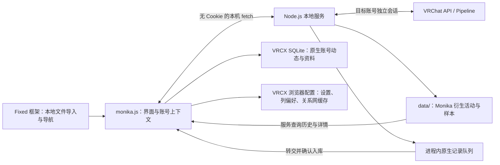

# Monika 数据流与账号隔离

## 组件关系

Fixed 管理插件代码副本、生命周期与侧栏导航。Monika 通过公开 `navigation` 接口注册自己的内容，不再修补框架的 Vue Router。主账号完成登录后，插件允许目标账号认证和数据同步。

## 认证与主账号保护

- 服务管理自己的 VRChat Cookie 和 Pipeline 连接，不使用 VRCX 原生主账号请求客户端。
- 本机 IPC 明确设置 `credentials: omit`、禁止重定向和缓存。
- 主账号身份同时检查认证流程与受保护路由；注销、自动登录、二步验证或切换时暂停目标账号操作。
- 会话代次检查阻止迟到的认证、详情和元数据请求覆盖新账号。
- 更新 VRCX 保存账号配置使用条件写入，重读并合并其他账号与已有字段。

## 采集、持久化和查询

服务用轮询与 Pipeline 事件驱动采集器。Monika 衍生事件按账号写入 `data/账号.ndjson`，包括活动边界、可见人员快照、加入 / 离开、活动内模型观察、世界名称和人数样本；模型名称缓存与 Monika 本地备注也由服务保存。历史、详情、人员统计和导出都通过本机接口读取这份档案。同一数据目录由锁限制为单写入进程。

原生用户与好友变化通过 VRCX 原生事件逻辑生成动态或简介，放入进程内队列，再由插件调用 VRCX 原生账号数据库方法写入副账号表。完整好友、收藏与用户响应沿用内存缓存；Monika 不再将原始用户事件或活动投影到 SQLite 扩展表 / 游戏历史表。VRCX 的原生账号表可以与直接登录副账号时的数据共存。

`/native-sync` 使用每个进程的队列身份和连续序号；插件写入成功后通过 `/native-ack` 确认并释放已处理队列。进度只保留在内存中，服务重启或更换数据目录时自动重置；重复转交由 SQLite 插入去重保证安全。旧 `/sync` 和持久化 Monika 游标已移除。服务退出会丢失尚未转交的原生队列，衍生 NDJSON 不受影响。

完整实例位置是活动归并键。并行实例分别维护位置最后观察时间、人员快照与人数采样。合并 buffer 判断短暂离开和恢复；在线时长取观察区间并集。恢复可以保留活动 ID 与起点，但人数未知段仍表现为缺口。

服务启动时重放当前数据目录的衍生事件到内存索引；原生好友动态始终从 VRCX 原生账号表查询。较大的个人档案需要更多内存与重放时间，未来可增加增量索引。旧版混合 NDJSON 保持可读，其中的原生观察可以转交 VRCX，但不展示在衍生活动中；旧 SQLite 扩展表保持原样且不再使用。清空或更换 `data/` 后活动只读取新目录，不会被旧 SQLite 档案或游标重新填充。

## 原生组件复用

`vendor/vrcx/` 固定原始源码及 SHA-256。构建把原始 Vue 组件、列定义、控件和关系网 Worker 编译进单文件插件；`native-source-adaptations.mjs` 在内存中应用只读入口与目标账号适配，不直接修改快照。

原生组件使用独立响应式状态和 API 适配器，表格、关系网与收藏显示偏好按账号保存。Monika 打开的原生世界 / 模型窗口读取目标账号资料；世界窗口提供的加入、邀请、收藏等操作继续由主账号处理。

## 验证范围

`framework-fixed.test.mjs` 使用真实 Fixed 构建产物、jsdom、内存 SQLite 与 fake IndexedDB 验证本地导入及生命周期。存储测试通过临时目录和实际 HTTP 接口验证原生 / 衍生数据边界、旧游标与空目录、服务重启、入库重试和旧 NDJSON 兼容；其他测试覆盖认证并发、事件归并、人数未知缺口、页面刷新与只读社交适配。

`npm run preview` 使用同一 Fixed fixture，所有账号、活动和请求均为合成数据。宿主全局 CSS 仅在预览编译，不注入实际 VRCX。自动化验证不替代真实 VRChat 认证和桌面宿主联调。
