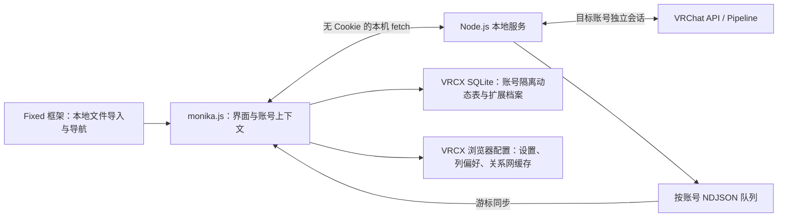

# Monika 数据流与账号隔离

## 组件关系

Fixed 管理插件代码副本、生命周期与侧栏导航。Monika 通过公开 `navigation` 接口注册自己的内容，不再修补框架的 Vue Router。主账号完成登录后，插件允许目标账号认证和数据同步。

## 认证与主账号保护

- 服务管理自己的 VRChat Cookie 和 Pipeline 连接，不使用 VRCX 原生主账号请求客户端。
- 本机 IPC 明确设置 `credentials: omit`、禁止重定向和缓存。
- 主账号身份同时检查认证流程与受保护路由；注销、自动登录、二步验证或切换时暂停目标账号操作。
- 会话代次检查阻止迟到的认证、详情和元数据请求覆盖新账号。
- 更新 VRCX 保存账号配置使用条件写入，重读并合并其他账号与已有字段。

## 采集、持久化和查询

服务用轮询与 Pipeline 事件驱动采集器。每个账号的事件按序写入 NDJSON，插件按游标增量导入 VRCX SQLite，再通过原生事件逻辑投影到目标账号前缀的动态、社交资料和隔离游戏历史表。Monika 扩展事件保留活动、人员、模型和人数样本。断线后的队列可以继续同步；同一服务数据目录由锁限制为单写入进程。

完整实例位置是活动归并键。并行实例分别维护位置最后观察时间、人员快照与人数采样。合并 buffer 判断短暂离开和恢复；在线时长取观察区间并集。恢复可以保留活动 ID 与起点，但人数未知段仍表现为缺口。

历史查询重放当前账号扩展事件到内存索引，原生好友动态从隔离数据库查询。较大的个人档案需要更多内存与重放时间，未来可增加增量索引。

## 原生组件复用

`vendor/vrcx/` 固定原始源码及 SHA-256。构建把原始 Vue 组件、列定义、控件和关系网 Worker 编译进单文件插件；`native-source-adaptations.mjs` 在内存中应用只读入口与目标账号适配，不直接修改快照。

原生组件使用独立响应式状态和 API 适配器，表格、关系网与收藏显示偏好按账号保存。Monika 打开的原生世界 / 模型窗口读取目标账号资料；世界窗口提供的加入、邀请、收藏等操作继续由主账号处理。

## 验证范围

`framework-fixed.test.mjs` 使用真实 Fixed 构建产物、jsdom、内存 SQLite 与 fake IndexedDB 验证本地导入及生命周期。其他测试覆盖数据库桥接、认证并发、事件归并、人数未知缺口、页面刷新与只读社交适配。

`npm run preview` 使用同一 Fixed fixture，所有账号、活动和请求均为合成数据。宿主全局 CSS 仅在预览编译，不注入实际 VRCX。自动化验证不替代真实 VRChat 认证和桌面宿主联调。
